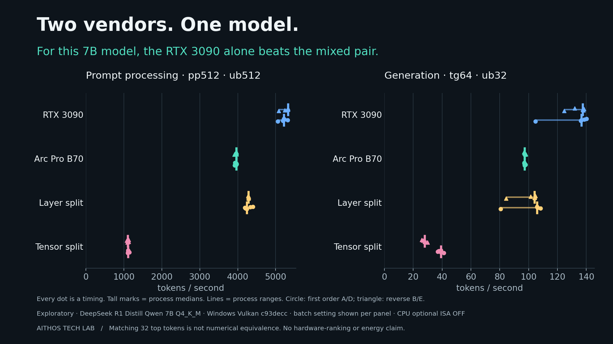
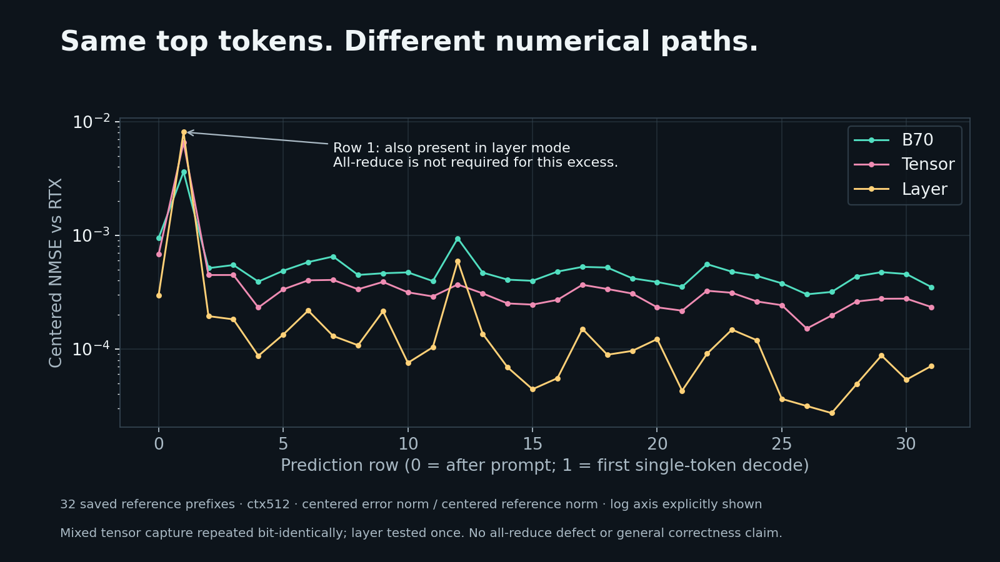

# Two vendors. One model. Does it help?

**Yes, an Intel Arc Pro B70 and NVIDIA RTX 3090 executed one model together. For the small 7B model and frozen build we measured, the equal-weight mixed configurations did not beat the RTX 3090 alone.** Layer splitting was consistently faster than tensor splitting. Widening the batch changed absolute prompt speeds substantially, but not the four-mode ordering. Prompt ratios versus the RTX are batch-sensitive, so the two prompt tables below are not one ratio.

Native Windows Vulkan, pinned llama.cpp **c93decc7654dac127d18fd61064565ef00bf8244**, DeepSeek-R1-Distill-Qwen-7B Q4_K_M. This public research report is prepared by Aithos Innovation and documents one exploratory benchmark; it is not a production recommendation. The implementation belongs to the llama.cpp / PR contributors; our contribution is the external test protocol, recorded cross-vendor measurements, reproducibility tooling, and analysis.

[Open the offline explorer](docs/index.html) · [Method and commands](METHOD.md) · [Recompute offline](VERIFY.md) · [Every sample](data/samples.csv) · [Source references](references.md)

## What we measured

- One i9-13900KF Windows 11 host, B70 nominal 32 GiB and RTX 3090 nominal 24 GiB. The 3090 is attached over OCuLink (operator-reported hardware detail; telemetry cannot identify a connector). Active telemetry samples include PCIe Gen1, Gen2, and Gen3, always at x4; **Gen3 x4 was the highest observed state**, not a fixed speed throughout inference. An A310 was enumerated and excluded from inference.
- Primary matrix: 12 sequential processes, pp128 / pp512 / tg32 / tg64 at depth 0, then pp512 / tg64 at depth 1024. Two reversed process orders at depth 0; one process block at depth 1024.
- One finite post-hoc batch sensitivity: 8 processes, pp512 / tg64 at batch / ubatch 512 instead of 32, two reversed orders. Same pinned libraries, model, drivers, sampler, and other runtime flags. Both batch and micro-batch changed together; effects are not separated.
- Five timed repetitions per test, bounded built-in warmup, 5 s delay per test, 120 s process watchdog. **20 benchmark processes, 280 timings**, no crash, timeout, or retry. Each process lasted 17.8–54.8 s including loading, warmup, and delays; these are not continuous stress tests.
- Every sample is retained. Tables show process-median ranges, not averages of all observations or independent n = 10 trials. The configuration ranking is consistent across blocks; there are no statistical-significance claims.

## The main comparison: generation, 64 tokens, depth 0, ubatch 32

| Configuration | Process medians, tok/s | All sample min–max, tok/s |
|---|---:|---:|
| RTX 3090 | 136.5–137.6 | 104.7–140.1 |
| Arc Pro B70 | 97.1–97.2 | 96.7–98.0 |
| Layer split | 104.0–105.9 | 80.6–108.2 |
| Tensor split | 27.9–39.1 | 26.0–41.2 |

Tensor throughput was **71.4–79.7% lower than RTX alone**, comparing medians within matched process blocks. Tensor generation varied strongly between blocks (27.9–39.1 tok/s). Do not turn that spread into one precise hardware speed claim. In 19 of 56 test records, the first timed repetition was more than 10% below its process median; built-in single-token generation warmup and depth-0 warmup did not eliminate every first-shape cost. Means and standard deviations remain original descriptive observations, not steady-state inference estimates. No slow samples were discarded.

## Prompt processing, 512 tokens, depth 0

The wide-batch table is the primary prompt comparison. The ubatch 32 table is the primary-matrix result, shown second. The four-mode ranking is the same in both. The ratios versus the RTX are not: layer rises from about 539 to 4243–4278 tok/s, tensor rises from 332–362 to 1107–1111 tok/s, and RTX rises from 1274–1301 to 5212–5321 tok/s. Quote a prompt ratio only with its batch.

### Primary prompt table: batch and ubatch 512

Separate sensitivity. Not pooled with the primary matrix.

| Configuration | Process medians, tok/s | All sample min–max, tok/s |
|---|---:|---:|
| RTX 3090 | 5211.8–5321.1 | 5058.4–5324.7 |
| Arc Pro B70 | 3961.8–3965.8 | 3913.8–3971.6 |
| Layer split | 4243.2–4277.9 | 4188.5–4396.2 |
| Tensor split | 1106.6–1111.3 | 1080.6–1141.6 |

### Secondary prompt table: primary matrix, ubatch 32

| Configuration | Process medians, tok/s | All sample min–max, tok/s |
|---|---:|---:|
| RTX 3090 | 1274.2–1300.6 | 1242.4–1307.6 |
| Arc Pro B70 | 443.4–443.9 | 443.2–444.8 |
| Layer split | 538.6–538.8 | 518.1–586.4 |
| Tensor split | 332.1–361.8 | 316.7–368.4 |

The wider batch helps all modes, most strongly the B70 and layer splitting. For example, the B70 goes from 443.4–443.9 to 3961.8–3965.8 tok/s process medians. This demonstrates why a small-batch comparison must not be advertised as a GPU performance ceiling. The RTX still leads, and layer still beats tensor. Depth 1024 results preserve the same ordering; only one process per mode was run there, so process-level repeatability at that depth is not established.

## Correctness: repeatable output, qualified arithmetic

All tested single and mixed modes agreed on **32/32 top-token IDs and 113 output bytes** for the fixed correctness prompt, `The capital of France is`. The original RTX / reference pair and the original / teacher-forced mixed tensor pair each had byte-identical full-vocabulary logits across their respective repeats (4,866,048 float32 values per run). Teacher forcing uses the saved reference prefixes, not each candidate's chosen tokens; control predictions are conditional argmax, not independent autonomous generation.

There is a persistent first-single-token-decode numerical excess. Centered NMSE versus the RTX at row 1 is 0.00361377 for the B70, 0.00655448 for tensor, and 0.00808399 for layer. **Layer mode also has the excess without any tensor all-reduce.** This shows all-reduce is not necessary for the phenomenon; it does not exclude an additional reduction contribution in tensor mode or identify a cause. The other 31 rows of both mixed modes are closer to the RTX than B70-only under the centered comparison. Matching 32 tokens does not establish equal probabilities or general correctness.

Raw NMSE divides by the raw reference norm; centered NMSE removes mean shifts and divides by the centered reference norm. They must not be compared as the same normalization. The raw 1e-6 advisory remains unmet and uncalibrated for cross-vendor Q4 kernels. Layer and B70 were not repeated. Correctness scope is one prompt and context 512. Benchmark workloads use synthetic token IDs, larger prompt shapes, and different padded contexts, which are not numerically certified by that gate.

## What the transport and memory evidence says

The private mixed tensor logs identify exactly the B70 then the 3090 and explicitly select the **generic all-reduce fallback**. The [pinned optimized route](https://github.com/ggml-org/llama.cpp/blob/c93decc7654dac127d18fd61064565ef00bf8244/ggml/src/ggml-vulkan/ggml-vulkan.cpp#L16017-L16045) requires matching driver UUIDs, semaphore-FD entry points, and exportable/importable opaque-FD timeline semaphores. The recorded driver UUIDs differ, so that requirement is not met; the generic log message alone does not isolate which capability check failed first. The optimized route was never forced. Private allocation logs record layer placement as B70 layers 0–14 and RTX layers 15–27 plus the output. Both devices held model buffers and completed the graph. Those raw logs are not distributed, so the public timing verifier cannot independently re-establish their device-allocation claims.

Memory charts use Windows WDDM device-wide dedicated-memory snapshots for both cards, mapped by DXGI adapter identity in the same boot session. This is observed memory, not per-test tensor allocation or a shared address space. The memory chart takes the maximum over all depth-0 processes, and every plotted maximum comes from the ub512 sensitivity blocks (D/E, two tests each), whose compute buffers are larger than ub32's. Allocation logs are separate: the layer model buffers were 1995.92 MiB + 2172.17 MiB; tensor's 2084.43 MiB Meta print is the **maximum child**, not a sum. Raw WDDM engine counters sometimes exceed 100; they are retained as unvalidated counter values, not published as GPU utilization percentages. Intel power, temperature, and dual-GPU energy are unavailable. NVIDIA device-wide temperature peaked at 67 °C; its 85 °C guard never triggered. This does not establish Intel thermal behavior.

PCIe Gen3 x4 has an encoding-adjusted theoretical budget near 3.94 GB/s per direction before transaction overhead. That is not measured bandwidth. The generic path has copy, synchronization, and host costs, and repeated coordination is a plausible contributor to tensor's slowdown. **No link-width, host-staging, or kernel A/B experiment was performed. We cannot assign a percentage of the slowdown to OCuLink.** PCIe causality is unknown.

Nominal 32 + 24 GiB is not 56 GiB of pooled, fully allocatable memory. The 7B model fits either card. Existing larger weights were 16.8–22.1 GB; none was a weight-only test exceeding B70 capacity. KV, scratch, and architecture support could change whether a particular configuration fits, but those larger models were not loaded. We did not download a model above 32 GiB to manufacture a capacity claim. A beyond-one-card capacity advantage remains **untested**.

## Limits that travel with the charts

1. **As-built implementation, not optimized hardware:** optional CPU ISA extensions were OFF from the original build cache. Host effects were not isolated. The recorded CMake flags do not include separate MSVC FMA or F16C cache options; those options are absent on MSVC, and AVX2 OFF prevents that path. See METHOD.md. Batch 32 is conservative; batch 512 is a separate runtime sensitivity. No inference-library rebuild was made.
2. **One host,** one model and quantization, short workloads, fixed clocks not enforced. Cache state was uncontrolled. Model hashing warms the OS file cache. Existing OBS, Overwolf, and NVIDIA layers were not changed; performance processes recorded the inherited environment but do not independently attest every active layer insertion.
3. WDDM sampling itself used 2.3–7.6 CPU-seconds per process; that instrumentation overhead was not isolated and may affect host-sensitive paths. NVIDIA compute-app checks are incomplete under WDDM; unrelated graphics activity cannot be excluded. A310 desktop activity was present and excluded from inference.
4. Within-process samples measure repetition variation, not independent process replicates. Two process blocks reveal order and session sensitivity; moderate depth has only one. No confidence intervals, energy efficiency, current-PR claims, or universal vendor rankings.
5. **Timing is not loading.** Pure loading time is unavailable for unmodified llama-bench. Process wall time includes loading, warmup, delays, inference, and collection overhead. Single warm-file-cache loading-call samples from separate correctness captures are in the preserved evidence, not a loading benchmark. Overlapping engine startup proxies are not pure loading.

## Reproducibility and review

The data pipeline used the independent **benchrun 0.2** importer, retaining producer rows, samples, and phase labels. `vendor/benchrun` is a local snapshot of the reusable project; this research does not make benchrun a project-specific engine. `scripts/verify.py` recomputes the published timing rates, medians, ranges, ratios, and explorer-data consistency with standard-library Python and no GPU. Full raw execution logs and numerical captures remain private. The tested upstream source is pinned by commit; no model weights or inference DLLs are bundled.

The report claims no first-ever result: comparable mixed-vendor and eGPU work exists, but this exact pinned Windows B70 + 3090 evidence is a distinct configuration, not a new tensor-parallel algorithm. See [references and credits](references.md).

## Preview and release

The interactive explorer is a static site at `docs/index.html`. It has no backend, cloud account, external JavaScript, CDN or telemetry dependency. The Vercel project configuration routes the root URL to the explorer.

This repository is the canonical technical record. Any later social or upstream submission should preserve the qualifications and follow the venue rules; this repository makes no upstream submission.

Only equal `1/1` mixed splits were tested. No split-ratio tuning or optimized CPU-build comparison was performed; these findings do not rule out a benefit for other models, ratios, workloads or software revisions.

## License

Original Aithos code and documentation are released under the [MIT License](LICENSE). See [license notices](LICENSE-NOTICES.md) for scope. Upstream llama.cpp and model terms remain separate.
